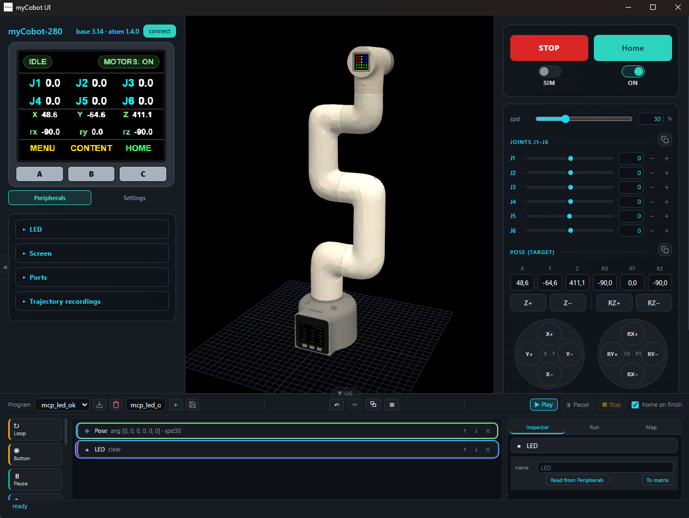

# myCobot UI v1.0

[Русская версия](README.md) · **English**



Ready-to-use release: a single-file application plus firmware for the
**myCobot 280 M5** manipulator (Elephant Robotics, M5Stack Basic base + M5Stack Atom
Matrix effector).

Custom firmware, a 3D interface, a hardware emulator and an MCP server that lets an
AI agent drive the robot. **No Python or Conda is needed on the target machine.**

## What is in the release

| File | What it is |
|---|---|
| `myCobot_UI_v1.0.exe` | The whole application (~36 MB): UI, 3D model, backend, emulator, MCP server, app icon |
| `firmware/mycobot_custom_base_v3.14.bin` | **Base** firmware (M5Stack Basic), v3.14 |
| `firmware/mycobot_custom_atom_v1.06.bin` | **Effector** firmware (Atom), v1.06 |
| `LICENSE` | MIT |

Order matters: **firmware first, application second** (at least the base — without it
there is no Wi-Fi and no extended opcode set). If the robot already runs our firmware,
update just the base over OTA.

---

# 1. Flashing the robot

## 1.0 What you need

- A USB cable (Type-C for the base, a separate cable for the Atom — it exposes an FTDI port).
- Virtual COM-port drivers (CP2104 or CH9102, depending on the board revision).
- Python 3.8+ with `esptool` — **only** for the Atom and for the very first USB flash of
  the base: `pip install esptool`. After that the base updates over Wi-Fi, no cable.
- PlatformIO — optional, only if you want to build the firmware from sources.

> **The one important rule.** You will see TWO COM ports: the base and the Atom.
> Flashing the **wrong port breaks the Base↔Atom bridge** (the arm stops responding).
> Before flashing, check in Windows Device Manager which COM port appeared after you
> plugged in the board you intend to flash, and use only that one.

## 1.1 Base (M5Stack Basic) — over USB

1. Connect the base to the PC, find its COM port (for example `COM5`).
2. Flash the application image:

```bash
python -m esptool --chip esp32 --port COM5 --baud 460800 write_flash -z 0x10000 mycobot_custom_base_v3.14.bin
```

3. If `esptool` cannot connect (`Failed to connect` / `Wrong boot mode`): power the
   robot off and on again and re-run the command **immediately**. There is no RESET
   button on the case — esptool resets the board into download mode itself via
   DTR/RTS; power-cycling is only needed if the board has hung.
4. Power-cycle after flashing: the screen shows **LINK** (joint angles, robot IP).
   If the screen stays empty, repeat from step 2.

`0x10000` is the app offset of the standard PlatformIO partition table. If the base was
previously flashed with something non-standard, use PlatformIO instead (sources live in
the main repository): `cd firmware && pio run --target upload --upload-port COM5`.

## 1.2 Base (M5Stack Basic) — over OTA (no cable)

Works only if the base **already** runs our firmware (which carries the OTA web server)
and the robot is on the same network as the PC.

1. Find the robot IP: shown on the base screen (LINK → `ROBOT IP`), in the application
   ("Connection" section), or via `ping mycobot`.
2. Flash:

```bash
curl -X POST http://ROBOT_IP/update -F "firmware=@mycobot_custom_base_v3.14.bin"
```

3. Verify the version: `curl http://ROBOT_IP/wifi/status` → field `fw_ver`, or in the
   application: Settings → "Firmware versions" (should read **3.14**).

The same thing from the UI: Settings → **OTA** → pick the `.bin` → "Upload".

## 1.3 Atom (effector) — USB only

1. Connect the **Atom** (port on the "wrist", FTDI connector) to the PC and find its COM port.
2. Make sure the LED matrix is not glowing full-brightness white — that sags USB power
   and drops the connection (reboot the robot; the matrix comes up green).
3. Flash:

```bash
python -m esptool --chip esp32 --port COM7 --baud 115200 --after hard_reset write_flash -fs 4MB -fm dio 0x10000 mycobot_custom_atom_v1.06.bin
```

4. **Baud rate must be 115200** — this board fails at 921600 ("Unable to verify flash chip").
5. After flashing, the Atom runs a self-test: the matrix is **red** during the check and
   **green** on success. On failure it stays red and the base screen shows the log
   (Settings → DIAG). A failure means torque was released: check power and cables.

## 1.4 Power-up order and verification

- Power-up order does not matter (the base and the Atom are powered separately): the
  Atom waits for the base to request its report and enters normal mode on its own.
- Version check: application → Settings → "Firmware versions" → base **3.14**, Atom **1.06**.
  Or by opcode: `0xC1` (base), `0x01` (Atom).

## 1.5 Rolling back to the stock firmware

Stock images are **not** included in this release (manufacturer rights) — download them
from Elephant Robotics or the `elephantrobotics` GitHub org and flash them with the same
commands (files `MyCobot280_basic_vX.Y.bin` and `MyCobot280_atom_vX.Y.bin`).

---

# 2. The application

## 2.1 Launch

1. Put `myCobot_UI_v1.0.exe` into a **dedicated folder** (say `C:\myCobot`).
2. Double-click it. Windows will ask about network access — **allow** it (needed for
   Wi-Fi to the robot, MCP on `127.0.0.1:8085` and robot discovery over UDP).
3. On first run the following appear next to the `.exe`:
   - `settings.json` — settings (robot address, language, theme, MCP parameters);
   - `programs/` — MiniIDE block programs;
   - `recordings/` — motion recordings downloaded from the robot;
   - `scenes/` — screen scenes.

   **The whole folder is portable**: copy it to another PC and your settings and
   programs come along.
4. The "myCobot UI" window opens (an embedded Windows window on the WebView2 engine).
   If the window does not appear, the UI opens in your default browser instead: the
   WebView2 engine is missing (Windows 11 ships it, an older Windows 10 may not have it).
   That does not break anything — the browser mode is fully functional. The runtime is
   only needed for the embedded window:
   <https://developer.microsoft.com/microsoft-edge/webview2/>.

The first launch is a bit slower (a one-off ~2–4 s unpack). An antivirus may complain
about a freshly built unsigned binary — normal for PyInstaller builds.

## 2.2 SIM and REAL modes

The toggle at the top:

- **SIM** — the robot is virtual (an exact copy at the protocol level). No hardware
  needed: move joints, write and play programs, watch the 3D model.
- **REAL** — commands go to the physical robot. While the toggle is on SIM, **not a
  single** frame reaches the hardware.

When switching to REAL you pick the sync direction: **Sim → Robot** (the arm moves to
the pose on screen) or **Robot → Sim** (the model picks up the actual pose).

## 2.3 Connecting to the robot

**USB:** Settings → Connection → type **USB (serial)** → port (`COM3`) → "Connect".

**Wi-Fi:** type **Wi-Fi (TCP)** → `IP:9000` → "Connect". The robot announces its own IP
(UDP packet to `:9002`), so the field usually fills itself; the "Find" button scans the network.

Moving the robot to a **different** network: the "Robot Wi-Fi" panel → SSID and password →
"Write (attempt)". The credentials go to the robot and live only in its EEPROM; no
password is stored on the PC. If the robot fails to connect it brings up its own access
point `myCobot` / `mycobot123` → `192.168.4.1:9000`.

## 2.4 Control

- **Joints J1–J6** — sliders and numeric fields; the step is set in the "STEP" panel
  (Shift — ×5).
- **Pose** — X/Y/Z, rx/ry/rz: "Read" captures the current pose, "Move" sends the target.
- **Axis buttons (jog)** — the axis moves while you hold the button.
- **Home / Stop / EMERGENCY** — "Home" moves to the active HOME profile (your own joint
  set), "Stop" holds the pose, "EMERGENCY" releases servo torque (the Atom button does
  the same).
- **Screen and LED** — the M5 screen state in the UI, image upload to the screen, a
  per-pixel 5×5 LED matrix editor.
- **Buttons on the robot:** A — menu, B — screen, C — enter/"home" (disabled in
  emergency state).

## 2.5 MiniIDE — programs without code

The panel at the bottom of the window. A program is a chain of blocks: Pose (joints or
coordinates), Linear move, Loop, Condition on button A/B/C, Screen, Port OUT·IN, Gripper,
Recording, Pause.

- Build with the mouse from the catalog on the left onto the canvas; parameters live in
  the "Inspector".
- **Play** — the program is executed by the **server**, not the browser: a closed tab or
  a sleeping laptop will not stop the cycle. Pause and stop are synchronized.
- Saving — `programs/*.json` (the "Save" button), the program list is in the IDE toolbar.
- An unreachable pose stops the program with an explicit error instead of silently
  continuing.

## 2.6 Control from an AI agent (MCP)

The application exposes an MCP server at `http://127.0.0.1:8085/mcp` (streamable HTTP).
About 47 tools: state, motion, GPIO, gripper, safety, screen/LED, kinematics, MiniIDE programs.

Client configuration (Claude Desktop, MiMoCode, Cursor, etc.):

```json
{
  "mcpServers": {
    "mycobot": { "url": "http://127.0.0.1:8085/mcp" }
  }
}
```

Clients that spawn the server as a subprocess need the stdio transport — it lives in the
sources (`mcpserver/run.py`); the packaged `.exe` offers HTTP only.

The agent sees the **same** robot as the operator and obeys the SIM/REAL toggle.
Dangerous operations (reboot, Wi-Fi changes, firmware upload) are **not** exposed to the
agent — they stay with the operator in the UI. Enable the server and pick tools in
Settings → **MCP**.

## 2.7 Firmware update from the application

Settings → **OTA** → pick a `.bin` from the `firmware/` folder → "Upload". No cable
needed, the robot must be on the network. This updates the **base only**; the Atom is
always flashed over USB (see 1.3).

## 2.8 Ports used by the application

| Port | Purpose |
|---|---|
| `1981` | UI and API (shown in the window) |
| `1982` | emulator → 3D model |
| `8085` | MCP server (`/mcp`) |
| `9001` | relay: stock `pymycobot` and external scripts connect here |
| `9002` | UDP: the robot announces its IP |

For `pymycobot` in third-party scripts use port **9001** on the machine running the
application (the firmware accepts only one TCP client on `:9000`, and the application
holds it).

## 2.9 Known limitations

- The numerical IK degenerates at the vertical pose (rx/rz gimbal lock) — the target is
  rejected with an error, the arm never drives into the garbage.
- Built-in captions on the base screen are Latin (the firmware draws ASCII strings).
  Arbitrary text, Russian and Chinese included, **does** reach the screen: the MiniIDE
  "Screen" block and scenes are rendered on the PC with a system font and sent to the
  LCD as an image. The application UI is available in RU / EN / ZH.
- Bluetooth is hidden in the connection list (not supported by the firmware).
- Cameras and sensors on the effector are not supported in this version.

## 2.10 Safety

- Before the first move make sure the workspace is clear and the arm is not resting
  against the table.
- Emergency stop — the **Atom** button (short press) or **EMERGENCY** in the UI:
  releases servo torque. Press again to restore torque.
- Do not leave REAL mode unattended.

---

# 3. Settings

Everything lives on the "Settings" subpage, grouped into accordion sections.

**Appearance** — UI language (RU / EN / ZH) and theme (dark / light). Applied
immediately, stored in `settings.json` under `view`.

**General**

- **Mode sync** — what happens when you switch to REAL: "Sim → Robot" (the arm moves to
  the pose drawn on screen) or "Robot → Sim" (the 3D model picks up the actual pose).
- **STEP** — step for the ± buttons and the mouse wheel: joints (1° by default), poses
  (5 mm/°), gripper (5 %). Shift on the button/wheel — ×5.
- **HOME** — home-position profiles. "Select" makes a profile active: the "Home" button
  and "home on finish" in programs move there. "Read" copies the current angles into the
  fields, "Save" writes the profile into `settings.json`, "Delete" removes it. The
  built-in `Default` (all zeros) cannot be overwritten.
- **Gripper** — type: claw on servo ID 7 (Feetech) or SG90 over PWM. "Calibrate" takes
  the current position as zero (2048). Control itself lives in the "Gripper" panel.

**Connection** — type (USB / Wi-Fi), port and baud rate or `IP:9000`, the robot search
button, and the "Robot Wi-Fi" panel for moving the robot to another network (credentials
stay in the robot EEPROM only).

**Firmware** — OTA update for the base plus the current firmware versions (base / Atom).

**MCP server** — enable, transport, port, per-tool checkboxes (or "all on / all off"),
restart button. Changes apply on the fly, no application restart.

**Logs** — an event feed (connections, errors, emergency stop) and servo telemetry:
voltage, temperature, torque presence per joint. Polling runs only while the tab is open —
it is 12 separate reads over the bus shared with the servos.

All settings live in `settings.json` next to the `.exe`; the file can be edited by hand.

# 4. Peripherals

**5×5 LED matrix (on the effector).** The "LED" section: 25 pixels, painted by clicking
or by "brushing" (hold and drag), the color comes from the palette next to it, "Clear"
turns everything off. Every pixel goes to the robot immediately (to the emulator in SIM).
MiniIDE has an "LED" block (a matrix snapshot or `clear`).

**Robot screen 320×240.** The "Screen" section is a scene editor:

- right-click the canvas for the menu: `+ Image…`, `+ Text`, `Up` / `Down` (layer order),
  `Delete`;
- click to select an element, drag to move it; the X / Y / W / H fields set position and
  size exactly;
- for text: the text itself (up to 24 characters), font (sans / serif / mono), size in
  px, color — a palette with an eyedropper;
- "Save" stores the scene as `scenes/<name>.json`; the scene list below has "Load" /
  "Delete";
- "To screen" renders the scene on the PC (system font, Pillow) into a 320×240 JPEG and
  sends it to the LCD. That is why Russian and Chinese text works on the screen — the
  "Latin only" limitation applies to the firmware's built-in captions alone.

**Ports (GPIO).** The "Ports" section exposes only the physically free pins of the base:

| Pin | Capability |
|---|---|
| **G26** (Grove port B) | input, output, PWM |
| **G34 / G35 / G36** | input only (no pull-up) |

Input: a read button and a 0/1 indicator. Output: a 0/1 toggle. PWM: frequency and duty
cycle. MiniIDE has a "Port OUT" block (several pins at once) and a "Port IN" block (waits
for a value, with its own chain of blocks inside). The remaining pins are not exposed:
some are taken by the Atom link, the LCD and the buttons, some are strapping pins that
must not be touched.

**Gripper.** The "Gripper" panel: open / close, position in % (or raw counts), step.
Type and calibration live in Settings → General. MiniIDE has a "Gripper" block.

**Motion recordings.** The robot records motion into its own memory (LIVE RECORD on the
base screen). "Download from robot" pulls new and changed sessions into `recordings/`;
each entry in the list has ▶ play, stop and delete. Playback moves the arm and obeys the
SIM/REAL toggle.

---

## Links

- Elephant Robotics — the robot vendor and stock software: <https://www.elephantrobotics.com>
- WebView2 Runtime: <https://developer.microsoft.com/microsoft-edge/webview2/>
- esptool: <https://github.com/espressif/esptool>

## License

MIT — see [LICENSE](LICENSE).
