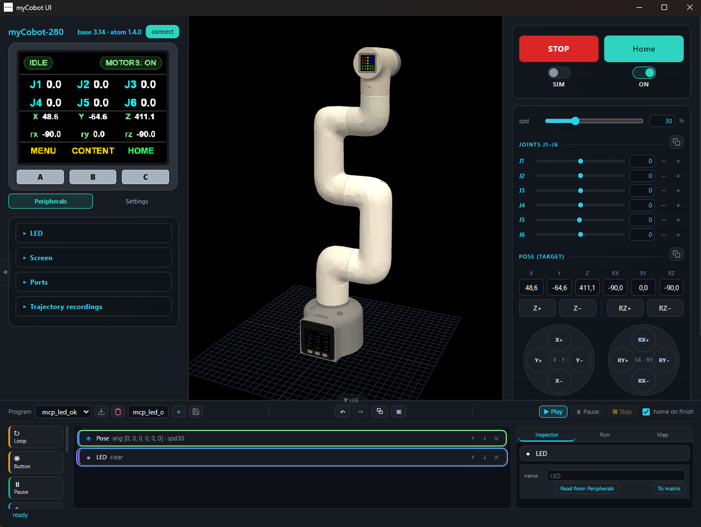

# myCobot UI v1.0

[English version](README.en.md) · **Русский**



Готовый релиз: приложение одним файлом + прошивки для манипулятора
**myCobot 280 M5** (Elephant Robotics, база M5Stack Basic + эффектор M5Stack Atom Matrix).

Кастомные прошивки, 3D-интерфейс, аппаратный эмулятор и MCP-сервер для управления
роботом из ИИ-агента. Python и Conda на машине пользователя **не нужны**.

## Состав релиза

| Файл | Что это |
|---|---|
| `myCobot_UI_v1.0.exe` | Приложение целиком (~36 МБ): UI, 3D-модель, бэкенд, эмулятор, MCP-сервер, иконка |
| `firmware/mycobot_custom_base_v3.14.bin` | Прошивка **Базы** (M5Stack Basic), v3.14 |
| `firmware/mycobot_custom_atom_v1.06.bin` | Прошивка **эффектора** (Atom), v1.06 |
| `LICENSE` | MIT |

Порядок: **сначала прошивки, потом приложение** (хотя бы База — без неё нет Wi-Fi и
расширенных опкодов). Если робот уже прошит нашей версией, обновите только базу по OTA.

---

# 1. Прошивка робота

## 1.0 Что понадобится

- USB-кабель (Type-C для базы, отдельный кабель для Atom — у него порт FTDI).
- Драйверы виртуального COM-порта (CP2104 или CH9102 — зависит от ревизии платы).
- Python 3.8+ с `esptool` — **только** для прошивки Atom и для первой прошивки Базы
  по USB: `pip install esptool`. Дальше база обновляется по Wi-Fi, без кабеля.
- Утилита PlatformIO — опционально, если хотите собирать прошивку из исходников.

> ⚠️ **Главное правило.** В системе будет ДВА COM-порта: база и Atom. Прошивка
> **не в тот порт ломает мост База↔Atom** (рука перестаёт отвечать). Перед прошивкой
> посмотрите в «Диспетчере устройств», какой COM появился после подключения нужной
> платы, и только его указывайте в команде.

## 1.1 Прошивка Базы (M5Stack Basic) — по USB

1. Подключить базу к ПК кабелем, найти её COM-порт (например `COM5`).
2. Прошить образ приложения:

```bash
python -m esptool --chip esp32 --port COM5 --baud 460800 write_flash -z 0x10000 mycobot_custom_base_v3.14.bin
```

3. Если `esptool` не может подключиться (`Failed to connect` / `Wrong boot mode`):
   выключить и снова включить питание робота и **сразу** повторить команду. Кнопки
   RESET на корпусе нет — автосброс в режим загрузки делает сам esptool по линиям
   DTR/RTS; питание нужно, только если плата зависла.
4. После прошивки перезагрузить питание: на экране появится **LINK** (углы суставов,
   IP робота). Если экран пустой — повторить прошивку с шага 2.

Адрес `0x10000` — стандартная таблица разделов PlatformIO (app). Если база раньше
прошивалась чем-то нестандартным, используйте PlatformIO: исходники в основном
репозитории, `cd firmware && pio run --target upload --upload-port COM5`.

## 1.2 Прошивка Базы — по OTA (без кабеля)

Работает, только если на базе **уже** наша прошивка (в ней есть веб-сервер OTA)
и робот в одной сети с ПК.

1. Узнать IP робота: он на экране базы (LINK → `ROBOT IP`), либо в приложении
   (раздел «Подключение»), либо через `ping mycobot`.
2. Прошить:

```bash
curl -X POST http://ROBOT_IP/update -F "firmware=@mycobot_custom_base_v3.14.bin"
```

3. Проверить версию: `curl http://ROBOT_IP/wifi/status` → поле `fw_ver`,
   либо в приложении: Настройки → «Версии прошивок» (должно быть **3.14**).

Через приложение то же самое: Настройки → **OTA** → выбрать `.bin` → «Загрузить».

## 1.3 Прошивка Atom (эффектор) — только по USB

1. Подключить **Atom** (порт на «кисти», разъём FTDI) к ПК, найти его COM-порт.
2. Убедиться, что LED-матрица не горит белым на полной яркости — иначе просадка
   питания по USB рвёт соединение (перезагрузите робота, матрица загорится зелёным).
3. Прошить:

```bash
python -m esptool --chip esp32 --port COM7 --baud 115200 --after hard_reset write_flash -fs 4MB -fm dio 0x10000 mycobot_custom_atom_v1.06.bin
```

4. **Скорость строго 115200** — на 921600 эта плата срывается («Unable to verify flash chip»).
5. После прошивки Atom проводит самодиагностику: матрица **красная** во время проверки,
   **зелёная** при успехе. При провале — красная остаётся, а на экране базы появится лог
   (Настройки → DIAG). Провал = снятый момент на сервах: проверьте питание и кабели.

## 1.4 Порядок включения и проверка

- Порядок включения **не важен** (питание базы и Atom раздельное): Atom ждёт запрос
  отчёта от базы и входит в режим сам.
- Проверка версий: приложение → Настройки → «Версии прошивок» → база **3.14**,
  Atom **1.06**. Либо опкодами: `0xC1` (база), `0x01` (Atom).

## 1.5 Откат на стоковую прошивку

Стоковые образы **не входят** в релиз (права производителя) — скачайте их с сайта
Elephant Robotics / из репозитория `elephantrobotics` и прошейте теми же командами
(файлы `MyCobot280_basic_vX.Y.bin` и `MyCobot280_atom_vX.Y.bin`).

---

# 2. Приложение

## 2.1 Запуск

1. Положить `myCobot_UI_v1.0.exe` в **отдельную папку** (например `C:\myCobot`).
2. Двойной щёлчок. Windows спросит про сеть — **разрешить** (нужно для Wi-Fi до робота,
   MCP на `127.0.0.1:8085` и UDP-обнаружения робота).
3. При первом запуске рядом с `.exe` создаются:
   - `settings.json` — настройки (адрес робота, язык, тема, параметры MCP);
   - `programs/` — блочные программы MiniIDE;
   - `recordings/` — записи траекторий, выгруженные с робота;
   - `scenes/` — сцены экрана.

   **Вся эта папка переносима**: скопировали её на другой ПК — настройки и программы поехали вместе.
4. Откроется окно «myCobot UI» (это встроенное окно Windows на движке WebView2).
   Если окно не появилось — интерфейс сам откроется в браузере: движка WebView2 в
   системе нет (в Windows 11 он есть изначально, в старой Windows 10 бывает не
   установлен). Это не мешает работе: браузерный режим полностью рабочий. Рантайм
   нужен только для окна: <https://developer.microsoft.com/microsoft-edge/webview2/>.

Первый запуск чуть дольше обычного (распаковка ~2–4 с). Антивирус может ругаться на
свежесобранный неподписанный бинарник — это нормально для PyInstaller-сборок.

## 2.2 Режимы SIM и REAL

Тумблер вверху:

- **SIM** — робот виртуальный (точная копия на уровне протокола). Железо не нужно:
  можно крутить суставы, писать и проигрывать программы, смотреть 3D.
- **REAL** — команды уходят на реального робота. Пока тумблер в SIM, на железо не
  уходит **ни один** кадр.

При переходе в REAL выбирается направление синхронизации: **Сим → Робот** (рука едет
в позу с экрана) или **Робот → Сим** (модель подхватывает фактическую позу).

## 2.3 Подключение к роботу

**USB:** Настройки → подключение → тип **USB (serial)** → порт (`COM3`) → «Подключить».

**Wi-Fi:** тип **Wi-Fi (TCP)** → `IP:9000` → «Подключить». IP робот сообщает сам
(UDP-пакет на `:9002`), обычно поле заполняется автоматически; кнопка «Найти» ищет робота в сети.

Перевод робота в **другую** сеть: панель «Wi-Fi робота» → SSID и пароль → «Записать
(попытка)». Логин/пароль уходят роботу и хранятся только в его EEPROM, на ПК пароль не
сохраняется. Если робот не смог подключиться, он поднимает свою точку доступа
`myCobot` / `mycobot123` → `192.168.4.1:9000`.

## 2.4 Управление

- **Суставы J1–J6** — слайдеры и поля; шаг задаётся в панели «ШАГ» (Shift — ×5).
- **Поза** — X/Y/Z, rx/ry/rz: «Считать» берёт текущую позу, «Двигать» отправляет цель.
- **Кнопки осей (Jog)** — движение, пока держите кнопку.
- **Домой / Стоп / АВАРИЯ** — «Домой» едет в активный HOME-профиль (свой набор углов),
  «Стоп» держит позу, «АВАРИЯ» снимает момент с серв (кнопка Atom делает то же).
- **Экран и LED** — состояние экрана M5 в интерфейсе, загрузка картинки на экран,
  по-пиксельная LED-матрица 5×5.
- **Кнопки на роботе:** A — меню, B — экран, C — вход/«домой» (в аварийном режиме не работает).

## 2.5 MiniIDE — программы без кода

Панель внизу окна. Программа = цепочка блоков: Поза (углы/координаты), Линейное
перемещение, Цикл, Условие по кнопке A/B/C, Экран, Порт OUT·IN, Гриппер, Запись, Пауза.

- Собирается мышью из каталога слева на канвас; параметры — в «Инспекторе».
- ▶ **Плей** — программу исполняет **сервер**, а не браузер: закрытая вкладка или
  уснувший ноутбук цикл не остановят. Пауза и стоп синхронизированы.
- Сохранение — `programs/*.json` (кнопка «Сохранить»), список программ в тулбаре IDE.
- Недостижимая поза — программа останавливается с явной ошибкой, а не «успешно» едет дальше.

## 2.6 Управление из ИИ-агента (MCP)

Приложение поднимает MCP-сервер на `http://127.0.0.1:8085/mcp` (стриминг-HTTP).
Доступно ~47 инструментов: состояние, движение, GPIO, гриппер, безопасность,
экран/LED, кинематика, программы MiniIDE.

Конфиг для клиента (Claude Desktop, MiMoCode, Cursor и др.):

```json
{
  "mcpServers": {
    "mycobot": { "url": "http://127.0.0.1:8085/mcp" }
  }
}
```

Для клиентов, которые запускают сервер подпроцессом, нужен stdio-транспорт — он живёт
в исходниках (`mcpserver/run.py`); в собранном `.exe` доступен только HTTP.

Агент видит **тот же** робот, что и оператор, и подчиняется тумблеру SIM/REAL.
Опасные операции (перезагрузка, смена Wi-Fi, прошивка) агенту **не отданы** — только
оператору в интерфейсе. Включение и выбор инструментов: Настройки → **MCP**.

## 2.7 Обновление прошивки из приложения

Настройки → **OTA** → выбрать `.bin` из папки `firmware/` → «Загрузить».
Кабель не нужен, робот должен быть в сети. Так обновляется **только база**;
Atom — всегда по USB (см. 1.3).

## 2.8 Порты, которые занимает приложение

| Порт | Назначение |
|---|---|
| `1981` | интерфейс и API (открывается в окне) |
| `1982` | эмулятор → 3D-модель |
| `8085` | MCP-сервер (`/mcp`) |
| `9001` | ретранслятор: сюда подключается стоковый `pymycobot` и внешние скрипты |
| `9002` | UDP: робот сообщает свой IP |

Для `pymycobot` в сторонних скриптах указывайте порт **9001** на машине с приложением
(прошивка пускает только одного TCP-клиента на `:9000`, его занимает приложение).

## 2.9 Известные ограничения

- Численный IK вырождается у вертикальной позы (гимбал-лок rx/rz) — цель отвергается
  с ошибкой, рука в мусор не едет.
- Встроенные подписи на экране базы — латиницей (прошивка рисует ASCII-строки).
  Произвольный текст, включая русский и китайский, на экран **выводится**: блок «Экран»
  в MiniIDE и сцены рендерятся на ПК системным шрифтом и уходят на LCD картинкой.
  Интерфейс приложения — RU / EN / ZH.
- Bluetooth в списке подключений скрыт (не поддерживается прошивкой).
- Камера/датчики на эффекторе этой версией не поддерживаются.

## 2.10 Безопасность

- Перед первым движением убедитесь, что рабочая зона свободна, а рука не упирается в стол.
- Аварийный стоп — кнопка **Atom** (короткое нажатие) или **АВАРИЯ** в интерфейсе:
  снимает момент с серв. Повторное нажатие возвращает момент.
- Не оставляйте REAL-режим включённым без присмотра.

---

# 3. Настройки

Всё лежит в подстранице «Настройки», по разделам-аккордеонам.

**Внешний вид** — язык интерфейса (RU / EN / ZH) и тема (тёмная / светлая).
Применяется сразу, хранится в `settings.json` в секции `view`.

**Общие**

- **Синхронизация** — что делать при переходе в REAL: «Сим → Робот» (рука едет в позу,
  нарисованную на экране) или «Робот → Сим» (3D-модель подхватывает фактическую позу).
- **ШАГ** — шаг для кнопок ± и колеса мыши над полями: суставы (по умолчанию 1°),
  позы (5 мм/°), гриппер (5 %). Shift на кнопке/колесе — ×5.
- **HOME** — профили домашнего положения. «Выбрать» делает профиль активным: кнопка
  «Домой» и «домой по завершении» в программах едут именно туда. «Считать» переносит
  текущие углы в поля, «Сохранить» пишет профиль в `settings.json`, «Удалить» убирает.
  Встроенный `Default` (все нули) перезаписать нельзя.
- **Гриппер** — тип: клешня на серве ID 7 (Feetech) или SG90 по PWM. «Калибровать»
  принимает текущее положение за нулевое (2048). Дальше управление — в панели «Гриппер».

**Подключение** — тип (USB / Wi-Fi), порт и скорость либо `IP:9000`, кнопка поиска
робота в сети, панель «Wi-Fi робота» для перевода в другую сеть (креды остаются только
в EEPROM робота).

**Прошивка** — OTA-обновление базы и текущие версии прошивок (база / Atom).

**MCP-сервер** — включение, транспорт, порт, галочки инструментов (или «все вкл / все
выкл»), кнопка перезапуска. Меняется на лету, без перезапуска приложения.

**Журналы** — лента событий (подключения, ошибки, аварийка) и телеметрия серв:
напряжение, температура, наличие момента по каждому суставу. Опрос идёт только при
открытой вкладке — это 12 отдельных чтений по общей шине с сервами.

Все настройки — в `settings.json` рядом с `.exe`; файл можно править и вручную.

# 4. Периферия

**LED-матрица 5×5 (на эффекторе).** Раздел «LED»: 25 пикселей — рисуются кликом или
«кистью» (зажать и вести), цвет выбирается палитрой рядом, «Очистить» гасит всё.
Каждый пиксель уходит на робота сразу (в SIM — в эмулятор). В MiniIDE есть блок «LED»
(снимок матрицы или `clear`).

**Экран робота 320×240.** Раздел «Screen» — редактор сцены:

- правый клик по холсту — меню: `+ Картинка…`, `+ Текст`, `Вверх` / `Вниз` (порядок
  слоёв), `Удалить`;
- клик — выбрать элемент, перетаскивание — переместить; поля X / Y / W / H задают
  координаты и размер точно;
- для текста: сам текст (до 24 символов), шрифт (sans / serif / mono), размер в px,
  цвет — палитра с пипеткой;
- «Сохранить» кладёт сцену в `scenes/<имя>.json`; список сцен ниже — «Загрузить» /
  «Удалить»;
- «На экран» рендерит сцену на ПК (системный шрифт, Pillow) в JPEG 320×240 и отправляет
  на LCD. Именно поэтому русский и китайский текст на экране работает — ограничение
  «только латиница» касается лишь встроенных подписей прошивки.

**Порты (GPIO).** Раздел «Ports» — только физически свободные пины базы:

| Пин | Что можно |
|---|---|
| **G26** (Grove port B) | вход, выход, PWM |
| **G34 / G35 / G36** | только вход (без подтяжки) |

Вход: кнопка чтения и индикатор 0/1. Выход: тумблер 0/1. PWM: частота и скважность.
В MiniIDE — блоки «Порт OUT» (сразу несколько пинов) и «Порт IN» (ждёт значение, внутри
своя цепочка блоков). Остальные пины наружу не отдаются: часть занята линией Atom,
LCD, кнопками, часть — strapping (их трогать нельзя).

**Гриппер.** Панель «Гриппер»: открыть / закрыть, позиция в % (или сырые counts), шаг.
Тип и калибровка — в Настройки → Общие. В MiniIDE есть блок «Гриппер».

**Записи траекторий.** Робот пишет движение в свою память (LIVE RECORD на экране базы).
Кнопка «Скачать с робота» забирает новые и изменённые сессии в `recordings/`; в списке
у каждой записи — ▶ проиграть, стоп и удалить. Проигрывание двигает руку и подчиняется
тумблеру SIM/REAL.

---

## Ссылки

- Elephant Robotics — производитель робота и стоковое ПО: <https://www.elephantrobotics.com>
- WebView2 Runtime: <https://developer.microsoft.com/microsoft-edge/webview2/>
- esptool: <https://github.com/espressif/esptool>

## Лицензия

MIT — см. [LICENSE](LICENSE).
